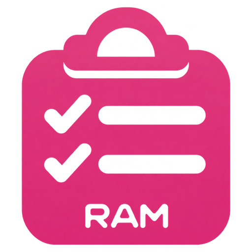
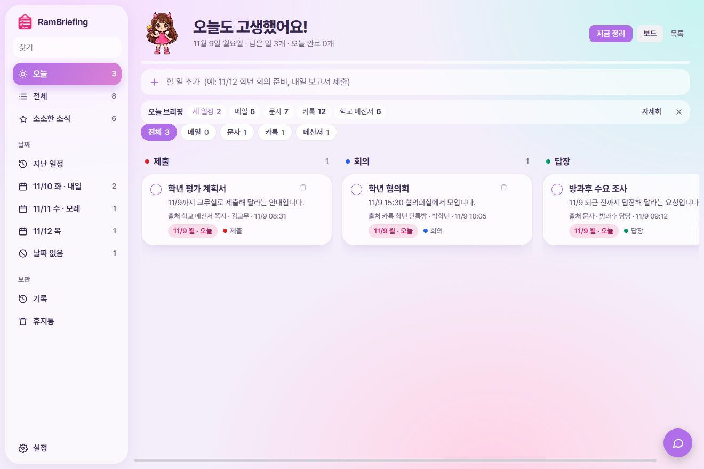
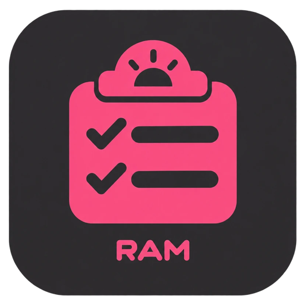
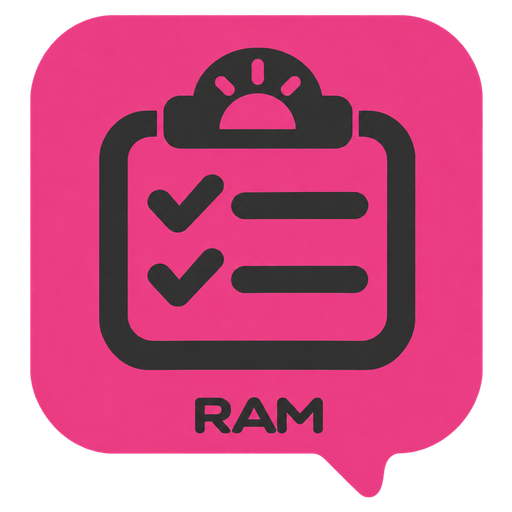
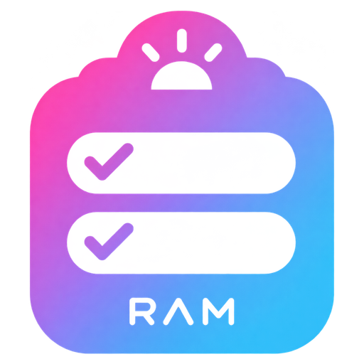
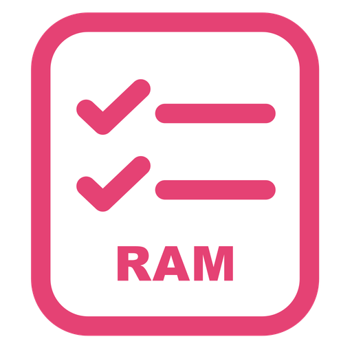

<h1 align="center">RamBriefing</h1>

아침마다 흩어진 연락을 모아 오늘 할 일로 정리해 주는 선생님용 할 일 앱

단톡방·문자·메일 곳곳에 흩어진 제출·신청·연수·회의 소식을 매일 아침 대신 읽어 두고, 출근하면 정리된 할 일만 확인하고 하나씩 체크하면 됩니다.

## 내려받기
[최신 설치 파일 받기](https://github.com/dpfkadpfka/RamBriefing/releases/latest). "Windows의 PC 보호"가 뜨면 [추가 정보 → 실행]을 누르세요. 새 버전은 자동으로 업데이트됩니다.

처음 켜면 아침 보고를 받을 컴퓨터, 읽을 자료, 시각, 정리할 AI를 고르는 화면이 나옵니다.

**[사용 가이드 보기](docs/guide/README.md)**

## 이런 걸 해요
- **아침 브리핑**: 정해 둔 시간에 카카오톡 PC 대화방과 휴대폰 문자(휴대폰과 연결)를 읽어 할 일과 소소한 소식을 뽑아 두고 윈도우 알림으로 알려 줍니다. 카톡이 로그아웃이면 건너뛰고 알려 줍니다.
- **학교 메신저 (선택)**: 브리티와 GOE 메신저가 설치된 PC에서 고르면 어제·오늘 받은 쪽지도 함께 정리합니다. 쪽지를 열어 읽으므로 읽음으로 바뀌고, 내용은 Claude로 보내집니다. 제미나이로 정리할 때는 읽지 않습니다.
- **정리할 AI**: 무료 제미나이 키 또는 Claude 구독. 메일 읽기와 캘린더 자동 입력은 Claude를 쓸 때만 됩니다.
- **집·학교 동기화**: 같은 구글 계정이면 할 일, 완료, 정리 결과가 맞춰집니다. 내 구글 드라이브의 앱 전용 공간에 저장합니다.
- **출처와 원본**: 카드마다 어디서, 누가, 언제 보냈는지 보여 주고, 원본 보기로 실제 메시지를 펼칩니다. 메일, 문자, 카톡, 메신저로 나눠 볼 수 있습니다.
- **할 일 정리**: 제출·신청·연수·촬영·회의·답장 같은 주제별 칸으로 나누고, 왼쪽 메뉴에서는 날짜별로 봅니다.
- **완료 기록**: 체크한 일은 그날까지 줄이 그어진 채 남고, 다음 날 '기록'으로 넘어갑니다.
- **구글 캘린더 연동**: 구글 로그인 후 버튼 하나로 할 일을 캘린더에 넣습니다.
- **브리핑 비서(챗봇)**: 남은 할 일과 캘린더를 보고 질문에 답합니다. 일정은 등록 버튼을 직접 눌러야 들어갑니다.
- **스킨 40여 종**: 교실 칠판, 픽셀 RPG, 그림책, 바다 수족관, 보드게임 말판, 레트로 컴퓨터, 공항 전광판 등.
- **내 마음대로**: 화면 제목, 부를 이름, 한 줄 문구, 제목·본문 글꼴, 글자 크기, 색, 배경 사진, **앱 아이콘 5종**.

## 앱 아이콘
설정 → 일반 → 앱 아이콘에서 고르면 창, 바탕화면, 시작 메뉴, 작업 표시줄 고정 아이콘이 함께 바뀝니다.

    

## 필요한 것
- Windows PC
- 구글 계정 (캘린더 연동)
- 챗봇을 쓰려면: Antigravity 설치와 구글 로그인
- 아침 브리핑을 쓰려면: 카카오톡 PC 버전, 휴대폰과 연결(안드로이드), 무료 제미나이 키 또는 Claude 구독. 정한 시각에 PC가 꺼져 있으면 다음에 켤 때 실행합니다.

## 개인정보
- 할 일과 설정은 내 PC에만 저장됩니다.
- 원본 보기를 위해 정리에 쓴 카톡·문자·학교 메신저 원문을 내 PC의 앱 폴더에 30일 보관하고, 그 뒤 자동으로 지웁니다. 원문은 동기화하지 않습니다.
- 무료 제미나이를 고르면 어제·오늘 문자와 카톡 내용이 정리를 위해 구글 제미나이로 보내집니다. 무료 키의 입력 내용은 구글 서비스 개선에 쓰일 수 있으니 약관을 확인하고 고르세요.
- 정리 결과는 동기화를 위해 내 구글 드라이브의 앱 전용 공간에 저장됩니다.
- 구글 로그인 정보는 PC 안에 암호화해 저장합니다.

## 폴더
- `앱/` 화면과 설치형 앱(Electron)
- `자동화/` 아침 브리핑 스크립트 (PowerShell)
