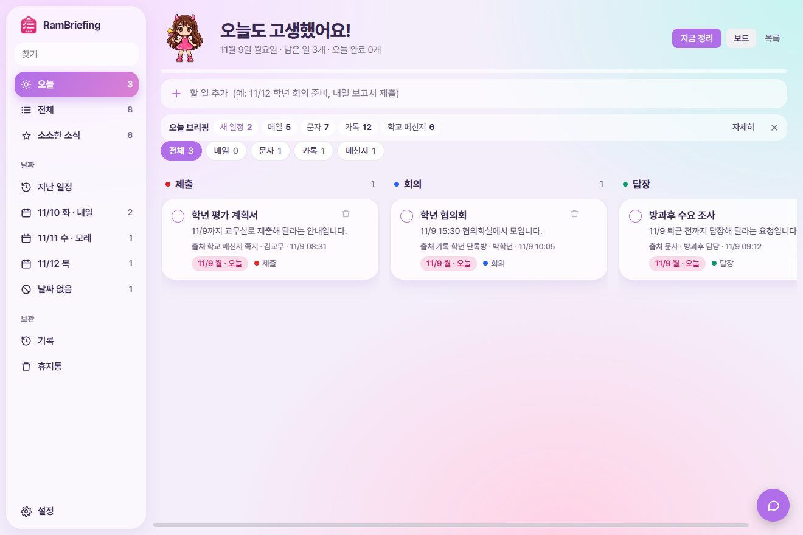
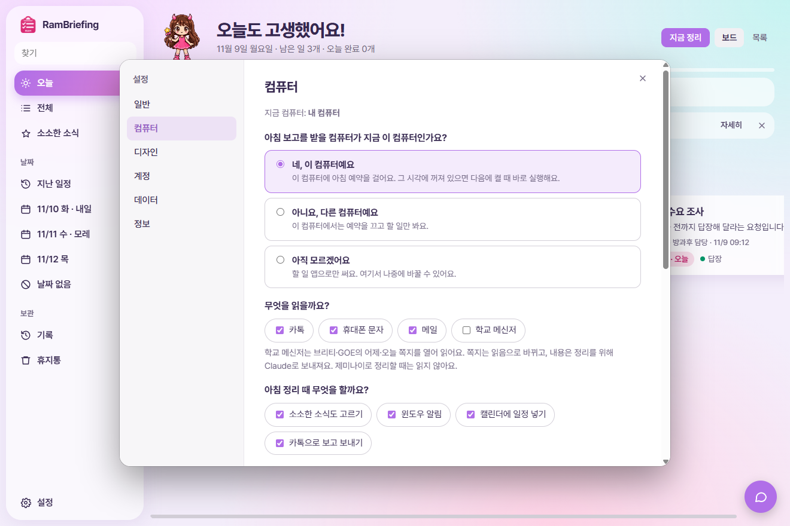
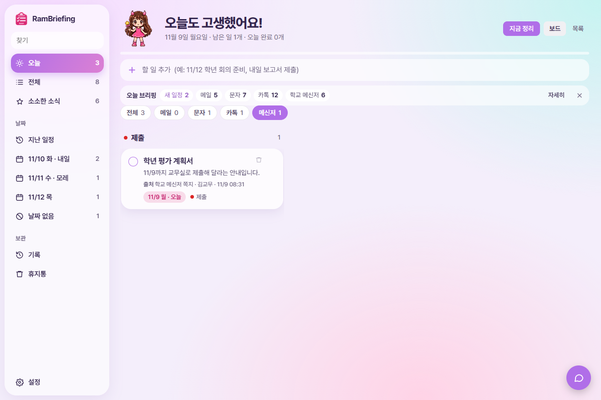
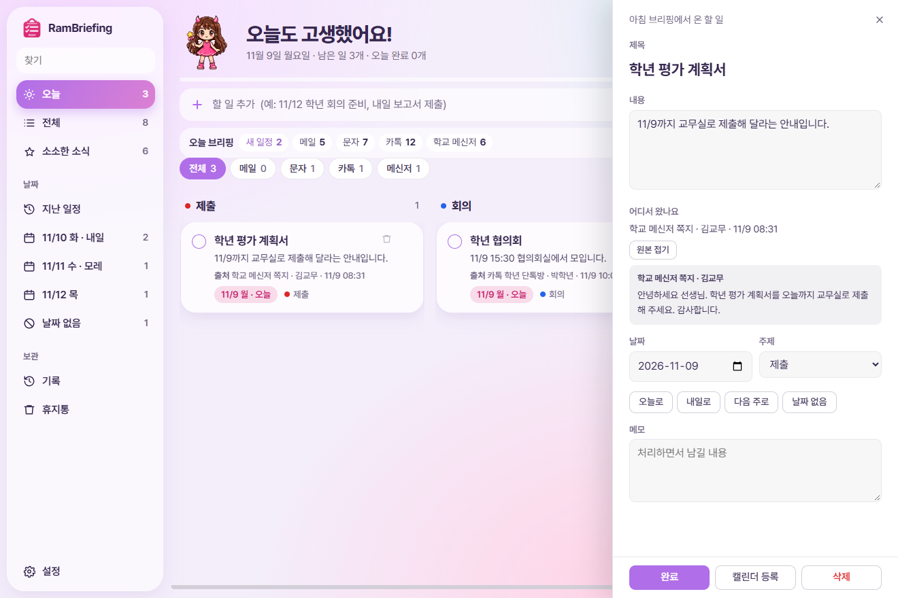
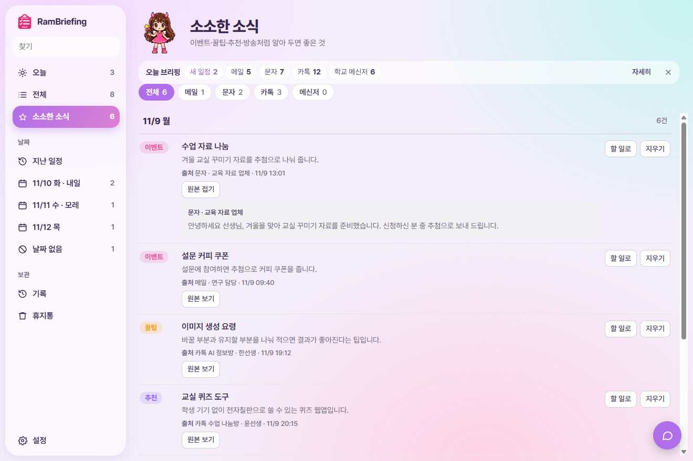
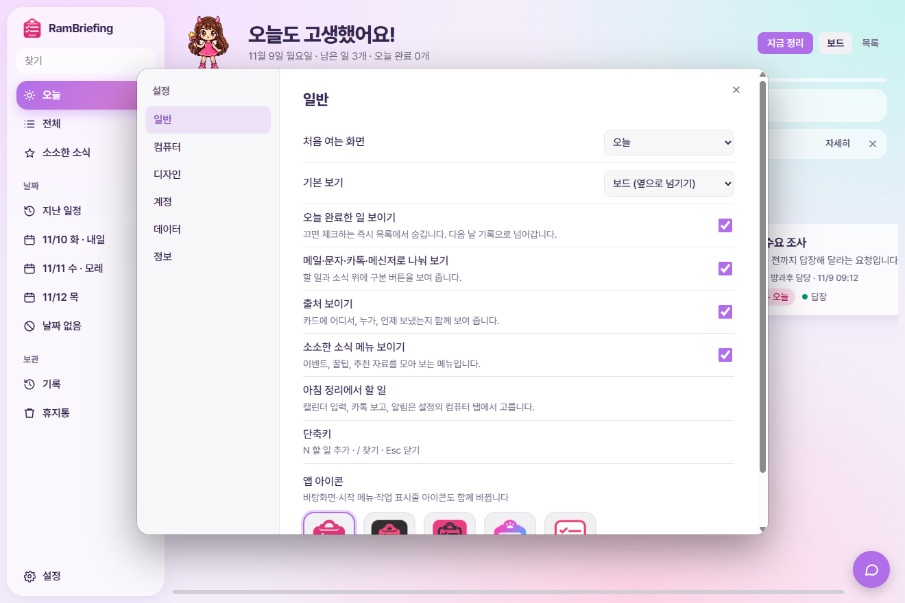
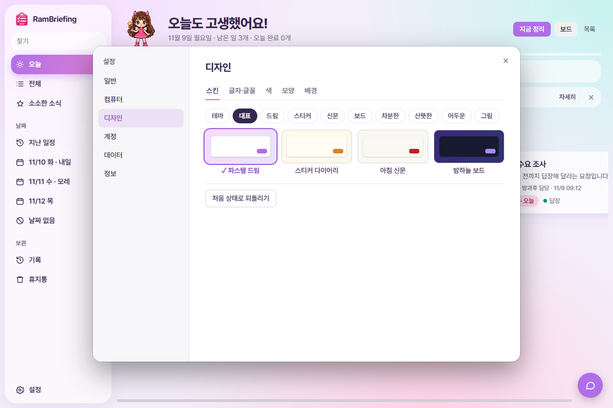
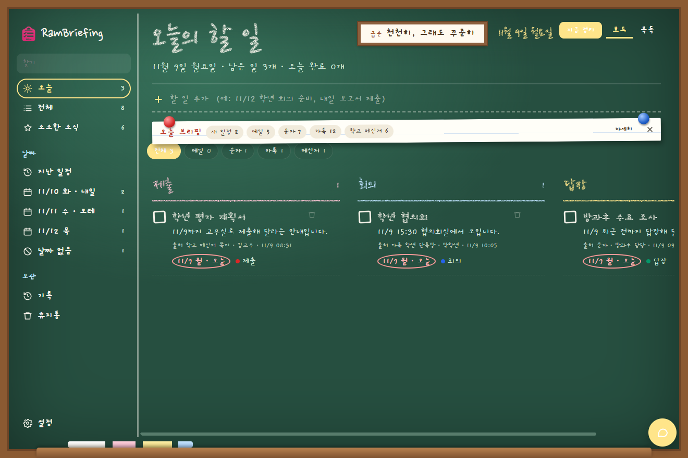

# RamBriefing 사용 가이드

단톡방, 문자, 메일에 흩어진 연락을 매일 아침 대신 읽어 오늘 할 일로 정리해 주는 앱입니다. 화면의 이름과 내용은 모두 예시입니다.

## 1. 설치하기

1. [최신 설치 파일](https://github.com/dpfkadpfka/RamBriefing/releases/latest)에서 `RamBriefing Setup` 파일을 받아 실행합니다.
2. "Windows의 PC 보호"가 뜨면 **추가 정보 → 실행**을 누릅니다.
3. 새 버전이 나오면 앱이 알아서 업데이트합니다.

Windows PC에서만 쓸 수 있습니다.

> **경기도교육청 선생님, 갤럭시 폰 사용자 기준으로 만들었습니다.** 다른 메신저는 설정에서 이름을 고르면 창에 보이는 글자까지 읽습니다. 아이폰 문자는 읽지 못하니 그 자료만 빼고 쓰면 됩니다.

## 2. 처음 설정

처음 켜면 설정 창이 한 번 뜹니다. 나중에 **설정 → 컴퓨터**에서 언제든 바꿀 수 있습니다.

| 묻는 것 | 고르는 법 |
|---|---|
| 아침 보고를 받을 컴퓨터 | 매일 아침 켜져 있는 컴퓨터에서 **네, 이 컴퓨터예요**를 고릅니다. 다른 컴퓨터에서는 **아니요**를 고르면 할 일만 봅니다. |
| 무엇을 읽을까요 | 카톡, 휴대폰 문자, 메일, 학교 메신저 중에서 고릅니다. |
| 아침 정리 때 할 일 | 소소한 소식, 윈도우 알림, 캘린더 입력, 카톡 보고를 각각 켜고 끕니다. |
| 몇 시에 받을까요 | 받고 싶은 시각을 고릅니다. 앱은 그보다 먼저 자료를 읽기 시작합니다. |
| 무엇으로 정리할까요 | 무료 제미나이 키 또는 Claude 구독을 고릅니다. |

마지막에 **저장**을 눌러야 아침 예약이 걸립니다.

### 정리할 AI 비교

| | 무료 제미나이 | Claude 구독 |
|---|---|---|
| 카톡, 문자 | 읽음 | 읽음 |
| 메일 | 읽지 않음 | 읽음 |
| 학교 메신저 | 읽지 않음 | 읽음 |
| 캘린더 자동 입력 | 안 됨 (할 일에서 직접 등록) | 됨 |
| 카톡 보고 | 안 됨 | 됨 |

### 읽을 자료별 준비

- **카톡:** PC 카카오톡을 설치하고 **자동 로그인**을 켜 둡니다. 꺼져 있어도 앱이 켭니다. 다른 컴퓨터에 로그인돼 있으면 이 컴퓨터로 가져오므로, 그 컴퓨터의 카톡은 로그아웃됩니다.
- **휴대폰 문자:** 윈도우의 **휴대폰과 연결**에 안드로이드 휴대폰을 연결해 둡니다.
- **학교 메신저:** 브리티 또는 GOE 메신저가 있는 PC에서만 나타나는 항목입니다. 로그인되어 있어야 합니다. 쪽지를 열어 본문까지 읽습니다.
- **다른 메신저:** 설정에서 메신저 이름을 고릅니다. 로그인되어 있어야 하고, 창에 보이는 글자만 읽어 본문이 잘릴 수 있습니다.
- **메일:** Claude 구독에 지메일을 연결해 둡니다.

## 3. 매일 쓰기

정한 시각이 되면 앱이 자료를 읽고 정리한 뒤 윈도우 알림으로 알려 줍니다. 그 시각에 PC가 꺼져 있으면 다음에 켤 때 실행합니다.

- **지금 정리:** 예약을 기다리지 않고 바로 정리합니다. 실수를 막기 위해 두 번 눌러야 시작합니다.
- **다시 시도:** 카톡을 읽지 못했을 때 공지 줄에 나타납니다.
- 정리하는 동안 카톡 창이 열렸다 닫힐 수 있습니다. 카톡을 읽을 때는 마우스가 움직이니 PC를 잠시 쓰지 말아 주세요.

## 4. 왼쪽 메뉴

| 메뉴 | 내용 |
|---|---|
| 오늘 | 오늘 날짜의 할 일 |
| 전체 | 끝내지 않은 모든 할 일 |
| 소소한 소식 | 이벤트, 꿀팁, 추천, 방송, 소식 |
| 지난 일정 | 날짜가 지났는데 끝내지 않은 일 |
| 날짜별 | 앞으로 있는 날짜별 할 일 |
| 날짜 없음 | 날짜를 찾지 못한 일 |
| 기록, 휴지통 | 지난날 완료한 일, 지운 일 |

## 5. 어디서 온 일인지 보기

### 메일, 문자, 카톡, 메신저로 나눠 보기

할 일과 소식 위의 버튼을 누르면 그 자료에서 온 것만 보입니다.

### 출처

카드마다 어디서, 누가, 언제 보냈는지 나옵니다. 자료에서 찾지 못한 칸은 "확인 안 됨"으로 표시합니다.

### 원본 보기

할 일 카드를 누르면 오른쪽에 상세 창이 열립니다. **원본 보기**를 누르면 실제 메시지가 펼쳐집니다. 소소한 소식은 항목 아래에 같은 버튼이 있습니다. 메일은 **메일에서 보기**로 지메일을 엽니다.

원본은 보고받는 PC에 30일 동안 보관합니다. 그 뒤에는 "원본을 찾지 못했어요"라고 나옵니다. 그림으로 된 표와 첨부 파일 내용은 원본 보기에 나오지 않습니다.

## 6. 할 일 다루기

- **완료:** 왼쪽 동그라미를 누릅니다. 그날까지 줄이 그어져 남고 다음 날 기록으로 넘어갑니다.
- **삭제:** 카드의 휴지통 아이콘을 누릅니다. 바로 **되돌리기**를 누르거나 휴지통에서 되살릴 수 있습니다. 지운 일은 다음 정리 때 같은 제목으로 나와도 다시 나타나지 않습니다.
- **수정:** 카드를 눌러 제목, 내용, 날짜, 주제, 메모를 바꿉니다.
- **캘린더 등록:** 구글에 로그인한 뒤 카드의 **캘린더 등록**을 누릅니다.
- **직접 추가:** 위쪽 칸에 "11/12 학년 회의 준비"처럼 적으면 날짜까지 잡힙니다.

## 7. 내 마음대로 바꾸기

**설정 → 일반**에서 처음 여는 화면, 기본 보기, 나눠 보기 버튼, 출처, 소소한 소식 메뉴, 앱 아이콘을 고릅니다.

**설정 → 디자인**에서 스킨, 글꼴, 글자 크기, 색, 배경 사진, 화면 제목, 부를 이름을 바꿉니다. 설정 창은 끌어서 옮길 수 있어 스킨을 고르면서 뒤 화면을 볼 수 있습니다.

## 8. 집과 학교에서 함께 쓰기

같은 구글 계정으로 로그인하면 할 일, 완료, 정리 결과가 맞춰집니다. 아침 보고는 컴퓨터 한 대에서만 받습니다. 다른 컴퓨터에서 **네, 이 컴퓨터예요**로 저장하면 이전 컴퓨터의 예약은 그 컴퓨터에서 앱을 켤 때 꺼집니다.

## 9. 문제가 생겼을 때

| 증상 | 해결 |
|---|---|
| 카톡을 못 읽었어요 | 카톡에 로그인되어 있는지 확인하고 **다시 시도**를 누릅니다. 다른 기기에서 로그인하면 이 컴퓨터의 카톡은 로그아웃됩니다. |
| 문자가 비어 있어요 | **휴대폰과 연결**에서 휴대폰이 연결되어 있는지 확인합니다. |
| 학교 메신저를 못 읽었어요 | 메신저에 로그인되어 있는지 확인합니다. 앱은 비밀번호를 입력하지 않습니다. |
| 아침에 정리가 안 됐어요 | **설정 → 컴퓨터**의 준비 점검을 보고 다시 저장합니다. 또는 **지금 정리**를 누릅니다. |
| 구글 동기화가 안 돼요 | **설정 → 계정**에서 로그아웃한 뒤 다시 로그인합니다. |
| 내용이 비어 있어요 | 처음에는 정리 결과가 없습니다. **지금 정리**를 누릅니다. |

## 10. 아직 없는 기능

- 시스템 트레이 아이콘은 없습니다. 앱을 닫아도 아침 정리는 윈도우 예약으로 실행됩니다.
- GOE 대화함은 읽지 않습니다. 브리티 대화방은 목록에 보이는 최근 메시지만 읽습니다.
- GOE와 브리티 외의 메신저는 쪽지를 열지 않고 창에 보이는 글자만 읽습니다. 그 외 메신저로는 아직 시험하지 못했습니다.
- 맥과 휴대폰용 앱은 없습니다. 아이폰 문자는 읽지 못합니다.

## 11. 개인정보

- 할 일, 설정, 원본은 내 PC에 저장합니다. 원본은 30일 뒤 자동으로 지웁니다.
- 정리를 위해 고른 자료의 내용이 선택한 AI(구글 제미나이 또는 Claude)로 보내집니다. 무료 제미나이 키의 입력 내용은 구글 서비스 개선에 쓰일 수 있으니 약관을 확인하고 고르세요.
- 학교 메신저에는 학생과 학부모 정보가 있을 수 있습니다. 학교 규정을 확인하고 켜세요.
- 학교 메신저 쪽지는 열어서 읽기 때문에 읽음으로 바뀝니다.
- 동기화를 켜면 할 일, 완료, 정리 결과가 내 구글 드라이브의 앱 전용 공간에 저장됩니다. 찾기에 쓰는 짧은 원문 문구도 할 일과 함께 저장될 수 있습니다.
- 구글 로그인 정보와 제미나이 키는 PC 안에 암호화해 저장합니다.
